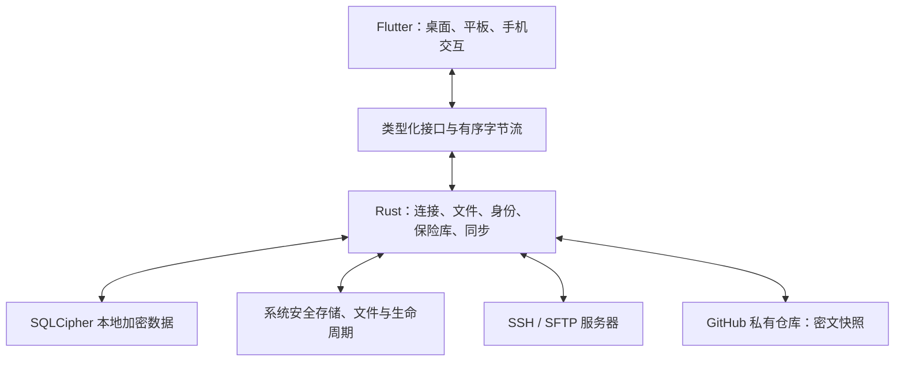

> 2026-10-04 执行路线已收敛到 [docs/ROADMAP.md](docs/ROADMAP.md)：本地转发 → 加密同步 → SSH 连接能力 → Apple 稳定化 → Windows。暂停 SFTP 新功能；以下能力矩阵与工期保留为长期规划，不再作为逐项开发顺序。

> 实施顺序更新：先 macOS + iOS/iPadOS 完成并验收，再启动 Windows；Android 在其余计划完成后单独评估，当前不创建工程。技术路线仍为 Flutter + Rust。下文四端矩阵是长期能力目标，不代表当前发布范围。

# 四端 SSH 客户端详细开发计划

## 一、产品目标与版本范围

### 1. 已确定的方向

开发一个面向个人开发者和运维人员的 SSH 客户端，覆盖 **Windows、macOS、Android、iPhone/iPad**，逐步达到专业 SSH 工具的完整度。

本计划按以下条件制定：

- **开发方式：**个人开发，AI 辅助，每周投入 10–15 小时。
- **发布定位：**先满足自己的日常使用，预留公开发布能力。
- **技术方向：**Flutter 自适应界面 + Rust 共享核心。
- **体验要求：**简约、操作顺手，分别遵循桌面、平板和手机的使用习惯。
- **同步要求：**主机、配置、密码和可导出的 SSH 私钥端到端加密同步，单项可设置为仅本机保存。
- **服务端范围：**现代 Linux/OpenSSH 为主，兼容常见 NAS 和 Windows OpenSSH。
- **交付方式：**macOS/iOS 先开发并验收，Windows 随后复用，Android 最后评估。

**产品成功的核心场景：在电脑配置服务器和密钥后，手机解锁同步数据即可连接；四端都能完成终端操作、文件管理和隧道配置。**

Termius 的公开功能包含连接组织、SFTP、工作区、密钥管理、跳板和转发等，本计划据此建立版本化功能清单。[Termius 功能表](https://termius.com/pricing)

参考资料说明：你提供的 CloudTerm 网站本次未能直接读取；另外检索到的[同名 Cloud Term 文档](https://cloud-term.luger.me/guide.html)仅作补充参考，尚不能确认两个域名属于同一项目。

### 2. “多端功能相同”的定义

| 维度 | 产品承诺 |
|---|---|
| 业务能力 | 首发功能在四端都有完整操作入口和验收用例 |
| 数据 | 共享相同模型、同步格式和加密规则 |
| 配置复用 | 身份、密钥、跳板、隧道、命令片段可重复引用 |
| 操作方式 | 桌面适配键鼠；手机适配触摸和软键盘；平板支持两者 |
| 工作区 | 同步会话组合与布局意图，各设备按可用空间呈现 |
| 系统限制 | 明确显示后台、文件授权和硬件能力造成的差异 |

需要保留三项边界：

- **同步连接配置不等于迁移正在运行的 SSH 连接。**跨设备继续远端工作，通过重新连接并附着远端 tmux 会话实现。
- **iOS 后台可能挂起应用。**提供准确的连接状态、回前台恢复和传输续传，不承诺 SSH、SFTP、隧道永久后台在线。[Apple 后台执行说明](https://developer.apple.com/documentation/uikit/about-the-background-execution-sequence)
- **硬件绑定私钥不能复制到其他设备。**这类身份只同步公钥和描述，软件私钥可以加密同步。[Apple Secure Enclave](https://developer.apple.com/documentation/security/protecting-keys-with-the-secure-enclave)

### 3. 功能矩阵

“V1.0”是完整首发目标；开发过程中的预览版可以只覆盖其中一部分。

| 模块 | V1.0：四端共同核心 | 后续增强 |
|---|---|---|
| 主机管理 | 分组、标签、收藏、搜索、最近连接、复制配置、批量移动 | 智能分组、更多客户端格式导入 |
| 身份复用 | 用户名、密码、密钥独立管理，多主机引用；分组默认值 | 外部密码管理器接入 |
| SSH 认证 | 密码、加密私钥、keyboard-interactive/MFA | SSH 证书、硬件身份、外部 Agent |
| 网络连接 | IPv4/IPv6、自定义端口、多级跳板、HTTP CONNECT/SOCKS5 代理 | 特殊网络设备及旧算法兼容 |
| 隧道 | 本地、远程、动态 SOCKS 转发；规则保存、启停、状态查看 | 流量统计、工作区联动 |
| 终端 | 多会话、ANSI/VT 常用能力、真彩色、Unicode、搜索、复制粘贴、字体和主题 | 多窗格工作区、广播输入、会话录制 |
| 移动输入 | Ctrl/Esc/Tab/方向键工具栏、中文输入、外接键盘、触摸选择 | 自定义辅助键布局 |
| SFTP | 文件管理、递归传输、队列、取消、重试、续传、冲突处理、权限查看与修改 | 目录对比、同步、服务器间传输 |
| 远程编辑 | 内置轻量文本编辑、保存前变化检查 | 外部编辑器接入、更大文件处理 |
| 密钥管理 | Ed25519 默认；RSA/ECDSA 兼容；生成、导入、导出、公钥部署 | FIDO2、设备硬件签名、证书生命周期 |
| 安全存储 | 本地加密、主密码、系统快速解锁、恢复码、加密备份 | 可信设备配对、更完整的设备管理 |
| GitHub 同步 | 私有仓库、细粒度令牌、凭证加密同步、冲突中心、恢复 | GitHub App 授权、自建存储适配 |
| 效率工具 | 普通命令片段、快速连接、基础快捷键 | 参数化片段、批量执行、工作区模板 |
| 导入导出 | OpenSSH config 常用字段、软件密钥、加密完整备份 | PuTTY 等格式的专用导入器 |

V1.0 不包含 RDP/VNC、Telnet、串口、AI 运维、团队权限和企业账号系统。Mosh、复杂硬件密钥等进入独立增强阶段。

---

## 二、界面与操作设计

### 1. 信息结构

主界面只保留五个一级区域：

1. **主机：**分组、收藏、搜索和连接入口。
2. **会话：**正在连接、已连接和可恢复的会话。
3. **文件：**SFTP 位置、传输任务和编辑器。
4. **密钥库：**身份、密码、密钥和已信任服务器。
5. **设置：**同步、安全、外观、快捷键和备份。

隧道与命令片段在相关主机、会话中提供快捷入口，同时支持集中管理。

新建主机默认展示名称、地址、用户名和认证方式；跳板、代理、隧道及算法设置放入高级选项。主机详情显示“实际生效配置”和继承来源，避免用户猜测最终使用哪个身份。

### 2. 各设备的交互

| 平台 | 布局与操作 |
|---|---|
| Windows | 左侧导航、顶部会话标签、终端与文件侧栏；右键菜单、拖放、键盘导航 |
| macOS | 桌面布局配合系统菜单栏、Command 快捷键、标准窗口行为和文件选择器 |
| Android | 底部导航、单页聚焦、系统返回行为、长按菜单、系统文件选择与分享 |
| iPhone | 紧凑导航、完整终端页面、辅助键盘、返回手势、安全区适配 |
| iPad/大屏 Android | 侧栏导航、双栏文件管理、可调整面板、外接键盘和指针支持 |

Flutter 的自适应设计覆盖布局和输入方式选择，但多数界面控件由 Flutter 绘制。文件选择、安全存储、生物识别、分享和生命周期通过平台接口接入。[Flutter 自适应设计](https://docs.flutter.dev/ui/adaptive-responsive)

### 3. 高频流程

**连接服务器**

- 收藏主机可直接连接。
- 初次连接显示服务器指纹，确认后保存。
- 指纹变化时阻断连接，提供查看旧值、新值和处理入口。
- 认证失败保留配置，允许切换身份和重试。
- 诊断按网络、跳板、协商、指纹、认证阶段说明问题。

**终端与文件切换**

- 当前主机一键打开对应 SFTP。
- 桌面默认终端与文件并排；手机切换到完整文件页面。
- 从文件菜单复制路径到终端，自动处理空格等字符。
- 默认不因重新连接而重放之前的命令。

**远程文本编辑**

- 首发内置编辑器处理不超过 5 MiB 的文本文件。
- 打开时保存远端文件状态，保存前重新检查。
- 检测到他人修改时展示冲突，允许比较、另存或明确覆盖。
- 支持时使用临时文件加原子重命名保存；不支持时提示保存方式的限制。

**跨设备初始化**

- 首台设备创建加密保险库，设置主密码并保存恢复码。
- 配置专用 GitHub 私有仓库，完成首次同步。
- 第二台设备独立授权 GitHub，使用主密码或恢复码解锁保险库。
- 同步完成即可使用可移植凭证；本机专属身份显示待配置状态。

### 4. 简约设计标准

- 使用系统明暗主题，默认一个强调色。
- 主机列表支持紧凑模式，避免大面积装饰卡片。
- 连接、文件和同步状态使用统一颜色与文案。
- 手机触控目标至少 44–48 逻辑像素。
- 终端中保留 Ctrl+C 的中断语义，复制使用平台适配快捷键。
- 多行粘贴提供预览；片段默认插入输入区，由用户确认执行。
- V1.0 包含中文、英文、屏幕阅读器标签及基本键盘可达性。

---

## 三、技术架构、数据与安全

### 1. 技术栈

| 层级 | 采用方案 | 职责 |
|---|---|---|
| 应用界面 | Flutter + Riverpod | 页面、交互状态、主题、导航 |
| 终端 | xterm.dart，封装独立适配层 | 终端解析、显示、选择和输入 |
| 共享核心 | Rust + Tokio | SSH、SFTP、任务调度、保险库、同步 |
| SSH/SFTP | russh + russh-sftp | 协议、认证、通道、转发和文件操作 |
| 跨语言调用 | flutter_rust_bridge | 类型化请求、异步事件、字节流 |
| 本地数据库 | Rust 管理的 SQLCipher | 加密业务数据、传输状态、同步日志 |
| 系统能力 | Swift/Kotlin/Windows 平台适配 | 安全存储、文件授权、生物识别、生命周期 |
| 持续集成 | GitHub Actions | 核心测试、四端构建、发布产物 |

russh 提供所需的 SSH 基础协议能力；xterm.dart 声明支持移动端、桌面端、中文及输入法，但终端兼容性仍需前置验证。[russh 项目](https://github.com/Eugeny/russh) · [xterm.dart](https://pub.dev/packages/xterm)

**实现边界：**

- Rust 持有连接、任务和长期凭据；Flutter 不直接实现另一套 SSH 或同步逻辑。
- 终端输出使用批量字节流、有界队列和背压，避免逐字符跨语言调用。
- UTF-8 解码必须保留跨数据块状态，避免中文和 emoji 被截断。
- 终端与大文件传输独立调度，避免传输阻塞输入。
- SSH 连接按主机、身份和网络配置隔离；配置相同时可复用传输连接及通道。
- 锁定启动时的稳定 SDK 与依赖版本，依赖升级通过兼容测试后进入主分支。

### 2. 共享数据模型

| 数据对象 | 关键内容 |
|---|---|
| Host | 地址、端口、身份引用、分组、标签、跳板链、代理引用 |
| Group | 父分组、默认连接参数 |
| Identity | 用户名、认证顺序、密码或密钥引用 |
| Key | 公钥、私钥密文或签名器引用、指纹、同步策略 |
| KnownHost | 服务器身份、端口、指纹和信任记录 |
| Tunnel | 类型、监听地址、目标地址、主机引用 |
| Snippet | 名称、正文和适用主机 |
| Workspace | 会话组合、面板关系和主机引用 |
| TransferJob | 源目标、进度、检查点和重试状态 |
| SyncRecord | 稳定 ID、格式版本、修订关系、删除标记和密钥世代 |

配置优先级固定为：**主机显式值 → 最近分组 → 上级分组 → 应用默认值**。编辑界面允许“继承”与“显式清空”，避免空值含义不明确。

平台目录、文件授权、窗口尺寸、GitHub 令牌、传输执行状态保存在本机。同步模型使用稳定 ID，不依赖本机文件路径。

### 3. 内部接口

首版提供内部类型化接口，不开放公共 HTTP 服务。

| 服务 | 最小能力 |
|---|---|
| ConnectionService | 连接、取消、认证交互、断开、诊断 |
| TerminalSession | 写入、调整尺寸、接收输出与连接状态 |
| SftpService | 列目录、文件操作、权限修改、读写 |
| TransferService | 建立任务、暂停、取消、重试、恢复 |
| TunnelService | 启停转发、查询状态 |
| IdentityService | 创建、导入、签名、公钥部署、加密导出 |
| VaultService | 创建、解锁、锁定、恢复、改密码、轮换 |
| SyncEngine | 拉取、合并、提交、冲突解决、重试 |
| PlatformServices | 安全存储、文件授权、生物识别、系统事件 |

正常认证通过凭据 ID 或签名句柄完成，避免把私钥长期保存在 Flutter 状态中。密码输入仍会短暂经过界面层，应及时清理并禁止日志记录。

### 4. 加密与恢复

采用成熟库完成密码运算，不自行设计加密算法。

**密钥结构**

- 创建随机 256 位保险库数据密钥。
- 主密码通过 Argon2id 派生包裹密钥，用于保护保险库密钥。
- 生成独立高熵恢复码，以另一条恢复路径保护保险库密钥。
- 同步记录采用 XChaCha20-Poly1305 认证加密，绑定保险库 ID、记录 ID、格式版本和密钥世代。
- 本地 SQLCipher 使用独立随机数据库密钥，由保险库密钥保护。

Argon2id 参数版本化保存，在最低配置真机上测试解锁时间和内存，读取参数时设置资源上限。[Argon2 RFC 9106](https://www.rfc-editor.org/rfc/rfc9106.html) · [认证加密说明](https://doc.libsodium.org/secret-key_cryptography/aead/chacha20-poly1305)

**本机解锁**

- Apple 平台使用设备级 Keychain 保护。
- Android 使用 Keystore 密钥包裹解锁材料。
- Windows 使用用户级 DPAPI 保护。
- 主密码为共同基线；支持的平台提供生物识别或系统认证快速解锁。
- 自动锁定后关闭保险库数据库、清除解密缓存并停止配置同步；已有会话的传输密钥与保险库解锁状态分别管理。

**保护范围**

主机名称、地址、用户名、备注、密码、私钥和片段均进入加密存储。检查数据库日志、临时文件、备份和错误报告，避免形成明文旁路。

用户主动下载到系统文件夹的文件遵循正常文件语义；GitHub 同步不包含这些文件和终端输出。

**恢复与轮换**

- 修改主密码重新包裹保险库密钥。
- 设备泄露后的安全轮换生成新数据密钥并重加密。
- Git 历史可能保留旧密文，轮换不能撤回已经泄露的内容。
- 主密码、恢复码和所有可信解锁设备均丢失时，无法恢复数据。
- 发布前必须在全新设备验证一次独立恢复。

### 5. GitHub 同步

**V1.0 采用专用私有仓库 + Fine-grained PAT。**

- 每台设备独立配置令牌，仅授权目标仓库的 Contents 读写。
- 令牌只保存本机，不进入同步数据，也不用于派生加密密钥。
- 使用固定同步分支及专用目录，不要求用户安装 Git。
- 密码和可导出私钥默认随保险库加密同步，初始化时说明；每项可改为仅本机。
- GitHub 不可用时，本地主机管理和可达服务器的连接照常工作。

**同步流程**

1. 本地事务保存修改，同时写入待同步队列。
2. 读取远端最新提交。
3. 根据上次同步基线、本地数据、远端数据进行三方合并。
4. 创建变化记录的密文对象和加密清单。
5. 创建 Git tree、commit，最后更新分支指针。
6. 分支更新成功后确认对应本地任务。
7. 遇到并发更新，重新拉取合并；禁止自动强制推送。

Git Data API 能把一批变化放入一个提交；最后更新分支，使其他设备看到完整快照。[Git Trees API](https://docs.github.com/en/rest/git/trees) · [Git References API](https://docs.github.com/en/rest/git/refs)

**冲突规则**

- 不同记录和不相交字段自动合并。
- 同字段同时修改保留两个版本，进入冲突中心。
- 私钥、密码、主机指纹作为完整安全字段处理，不按时间戳静默覆盖。
- 删除保留删除标记；删除与修改冲突可恢复。
- 同步得到的新服务器指纹不能自动批准本机观察到的身份变化。
- 旧客户端遇到无法理解的新格式停止写入并提示升级。

**触发和异常处理**

启动、恢复前台、手动操作和编辑后防抖触发同步；前台定期检查远端更新。处理令牌失效、限流、仓库改名、空仓库、分支保护和推送响应丢失。仓库转为公开时暂停同步并提示处理。

GitHub 可看到仓库访问、提交时间和密文大小等元数据，业务内容由客户端加密保护。

---

## 四、开发阶段与工期

### 1. 工期口径

这是从空项目开始的工程估算，已考虑 AI 辅助，但假设你能够独立排查 Flutter、Rust 和平台构建问题。

- **基础工作量：900–1,300 小时。**
- **加入约 30% 的跨端整合和返工预留：约 1,200–1,700 小时。**
- 每周投入 10–15 小时，对应完整首发约 **19–40 个月**。

主要工作量来自终端输入、四端生命周期、SFTP 异常恢复和加密同步正确性。每个阶段都交付可安装版本，早期版本即可逐步用于日常连接。

### 2. 阶段计划

| 阶段 | 基础工时 | 主要工作 | 完成条件 |
|---|---:|---|---|
| P0：四端技术验证 | 60–80h | 构建、Rust 桥接、最小 SSH/SFTP、中文输入、生命周期测试 | 四端真机可连接、传文件、运行 vim/tmux |
| P1：安全的基础客户端 | 100–140h | 主机、身份、软件密钥、本地保险库、基础终端、加密备份 | 重启后解锁即可连接，备份可恢复 |
| P2：终端与连接管理 | 130–180h | 多会话、搜索、分组继承、输入适配、片段、导入、认证诊断 | 常用终端程序和移动输入稳定 |
| P3：完整 SFTP | 140–190h | 文件管理、队列、续传、权限、文本编辑、冲突和文件授权 | 断网、取消、重启不破坏目标文件 |
| P4：GitHub 加密同步 | 150–220h | PAT、密文快照、合并、恢复码、冲突中心、版本迁移 | 四端并发和离线修改不静默丢数据 |
| P5：跳板与隧道 | 80–120h | 多跳、连接代理、三类转发、状态和资源释放 | 经跳板完成终端、SFTP和转发 |
| P6：各端体验打磨 | 100–140h | 菜单、快捷键、触摸、平板、分享、无障碍和性能 | 同一核心流程在四端顺畅完成 |
| P7：V1.0 稳定化 | 140–230h | 完整回归、加密落盘检查、安装升级、恢复文档、长期日用 | 满足首发验收，已知限制有明确说明 |

**P0 是必须通过的前置阶段。**如果终端输入或四端构建存在阻断问题，先修复适配层或受控 fork，再扩展业务功能。

P0 的 60–80 小时按你的投入约为 4–8 周，不能按全职“两周”安排。

### 3. 阶段可用成果

- **P1 后：**基础 SSH 和安全凭证保存，可开始日常试用。
- **P3 后：**具备完整本地 SSH/SFTP 工作流。
- **P4 后：**主机和凭证跨端复用闭环成立。
- **P7 后：**发布四端共同核心 V1.0。

### 4. V1.0 之后的路线

| 版本 | 明确增加的能力 |
|---|---|
| V1.1：效率增强 | 分屏工作区、模板同步、参数化片段、显式广播输入、GitHub App 授权 |
| V1.2：专业访问与文件 | SSH 证书、Agent forwarding、系统 Agent、更多导入格式、服务器间传输和目录对比 |
| V1.3：移动与硬件增强 | Mosh、FIDO2、设备硬件 SSH 身份、更完整的恢复和设备管理 |

Mosh 需要远端部署支持组件；硬件密钥按实际设备与接口建立兼容矩阵。这些版本在 V1.0 日用反馈后分别估时，不挤占首发质量工作。

### 5. 个人与 AI 的协作方式

- 每个开发任务控制在约 4–8 小时，写明行为、接口、测试和完成条件。
- AI 用于页面、平台适配初稿、测试场景、协议封装和问题分析。
- 加密流程、主机验证、冲突合并和数据迁移由你逐项复核。
- 每周完成一次目标功能演示和必要的四端回归。
- 涉及跨端模型的变更，在同一任务中更新四端接口，避免长期分叉。
- 默认使用测试服务器和测试凭据开发，不把真实私钥送入 AI 提示或日志。

---

## 五、测试、发布与首发验收

### 1. 首发平台默认值

为控制个人维护成本，首发采用以下产品基线：

| 平台 | 默认范围 |
|---|---|
| Windows | Windows 11，x64 |
| macOS | macOS 14+，Apple Silicon |
| Android | Android 10+，arm64 |
| Apple 移动设备 | iOS/iPadOS 17+ |

Windows 10、Intel Mac、Windows ARM64 和更旧移动系统列入后续兼容任务。这些是本项目的支持范围选择，框架实际支持范围以锁定版本为准。[Flutter 平台支持](https://docs.flutter.dev/reference/supported-platforms)

测试设备至少包含 Windows、Mac、Android 手机和 iPhone；平板布局需在发布前完成实际设备验证。模拟器用于补充尺寸和系统版本覆盖。

### 2. 必须覆盖的测试

| 类别 | 关键场景 |
|---|---|
| SSH | 密码、私钥口令、交互认证、认证失败、指纹变化、跳板任一层失败、取消 |
| 终端 | vim、tmux、htop；中文输入、emoji、宽字符、替代屏幕、鼠标模式、旋转和缩放 |
| SFTP | 空文件、大文件、大目录、中文路径、权限不足、磁盘满、符号链接、覆盖和取消 |
| 续传与编辑 | 校验已有片段、源文件变化、进程重启、远端文件被他人修改 |
| 生命周期 | 后台、锁屏、睡眠、杀进程、Wi-Fi/蜂窝切换、文件授权撤销 |
| 同步 | 四端全部方向、并发修改、删除冲突、时钟不一致、令牌撤销、限流和超时 |
| 加密 | 四端统一测试向量、错误口令、篡改、对象替换、恢复码、密钥轮换 |
| 迁移 | 老数据升级、失败恢复、旧客户端读取新格式、加密备份恢复 |
| 隧道 | 三类转发、端口占用、服务端拒绝、断线后监听和资源释放 |

SFTP 测试通过客户端与测试服务器分别计算文件摘要验证结果；不把服务端是否提供校验扩展作为通用前提。

### 3. 性能验收目标

以下作为 P0 起持续测量的工程目标：

- 10,000 条主机数据下，搜索响应 P95 不超过 150ms。
- 中等配置设备上，常规列表滚动和终端操作保持接近 60fps。
- 普通输入处理的客户端额外延迟 P95 不超过 30ms，不含网络时间。
- 桌面 10 个、移动端 4 个活动会话与文件传输并行时，输入仍可响应。
- 默认滚屏缓存有明确行数与内存上限；关闭会话后资源可回收。
- 大文件传输内存不随文件大小线性增长。
- 前台、网络正常时，少量配置变更在另一设备一个同步周期内可见，目标不超过 60 秒。

性能结论记录测试设备、系统版本、数据量和网络条件。

### 4. 构建与分发

- **开发期：**Windows 安装包、macOS 应用、Android APK、iOS 开发签名安装。
- **测试期：**固定测试渠道，iOS 使用 TestFlight，四端显示同一应用版本与数据格式版本。
- **公开发布准备：**桌面签名与更新校验、移动商店流程、隐私说明、依赖许可清单。
- **升级：**数据库迁移前自动生成加密备份；迁移失败恢复旧数据。旧版本不能写入不兼容的新格式。
- **故障报告：**默认本地保存脱敏诊断，用户主动导出；不采集终端内容和私钥。

### 5. V1.0 完成标准

全部满足后，才把预览版升级为完整首发：

1. 四端均可独立完成 SSH、SFTP、密钥管理、跳板和三类隧道操作。
2. 新设备恢复保险库后，可使用同步的软件凭证连接服务器。
3. 离线编辑和并发同步不会静默丢失配置、密码或私钥。
4. 指纹变化、密文损坏、格式不兼容不会被静默接受。
5. 网络中断、应用重启和后台恢复不会自动重复执行命令。
6. 数据库、日志、备份和同步仓库通过测试秘密的明文泄漏检查。
7. 中文输入、外接键盘、移动选择复制及远程编辑通过实际设备验收。
8. 完成至少四周四端轮换日用，阻断连接、破坏数据和泄露凭据的问题全部修复。

**实施起点确定为 P0：先用 60–80 小时完成四端真实 SSH/SFTP 与终端输入验证，再以安全的基础客户端为第一个可日用成果。**
